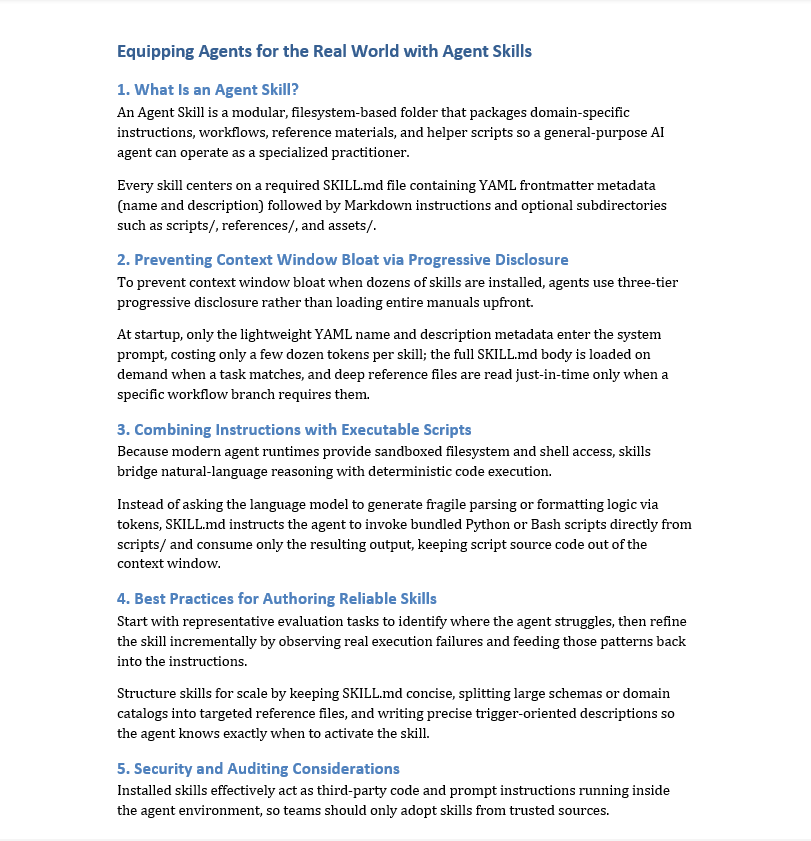
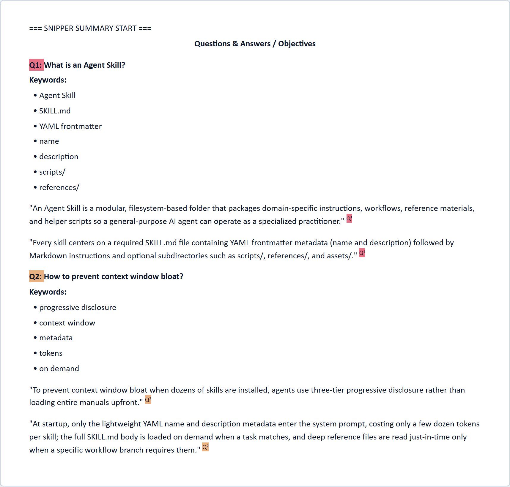
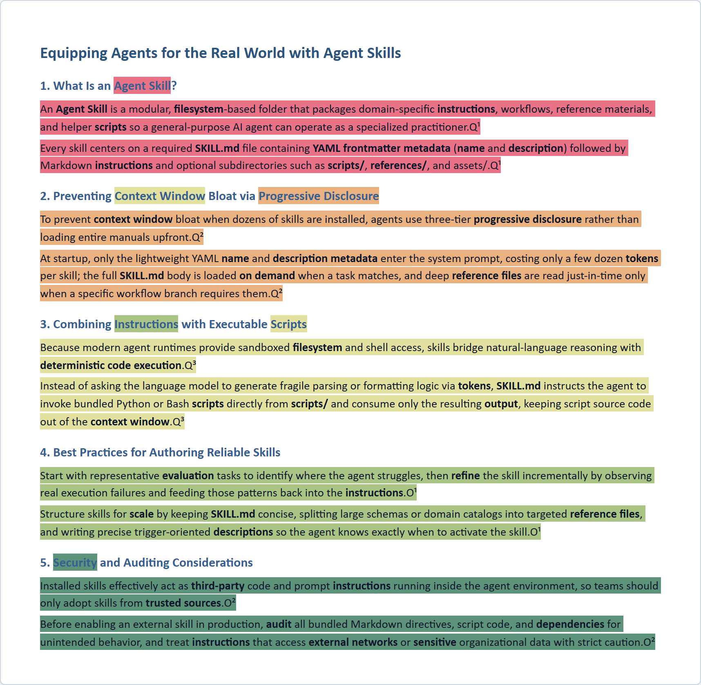
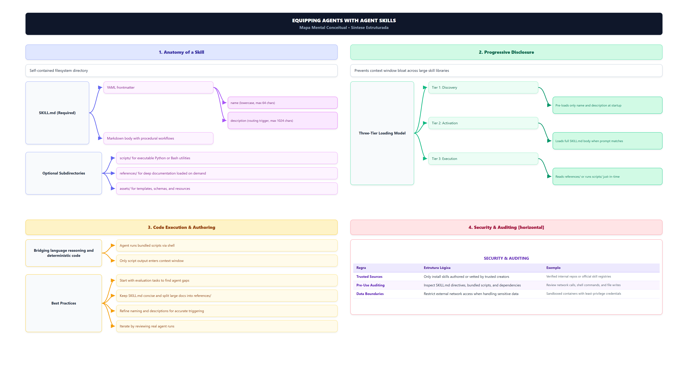

# Snipper

**AI-Assisted Document Analysis, Semantic Word/Google Docs Highlighting (`snipper`), and Automated Draw.io Mind Mapping (`mental-map`).**

Snipper is a modular toolkit designed to transform unstructured study materials, technical specifications, and structured notes into annotated reference documents and visual architecture diagrams. It runs locally out-of-the-box with zero cloud dependencies and optionally integrates with **Google Drive** and the **Google Docs API**.

---

## Core Modules

### 1. `snipper` — Semantic Answer Discovery & Document Highlighter
Analyzes Word documents (`.docx`) and Google Docs (`.gdoc`) against decoupled Questions (`Q#`) and Objectives (`O#`), performs multilingual lexical matching (`en` / `pt-BR` via spaCy), and applies idempotent, in-place visual annotations.

- **Decoupled Architecture**:
  - `<name>.docx` — Source document
  - `<name>.txt` — Clean plain-text companion with `[P#]` paragraph coordinates
  - `<name>.questions.txt` — Questions (`Q#`), Objectives (`O#`), `- Keywords:`, and `- Concepts:`
  - `<name>.findings.json` — Structured verbatim evidence payload validated against [findings.schema.json](.agents/skills/snipper/references/findings.schema.json)
- **Idempotent In-Place Mutation (`hlt`)**:
  - Prepends a clean, delimited summary block (`=== SNIPPER SUMMARY START ===` ... `=== SNIPPER SUMMARY END ===`) with bullet-pointed keywords, bold target headers, spaced verbatim quotes, and color-coded superscript citations (`Q¹`, `O¹`).
  - Highlights target keywords across the document body, bolds matched terms inside answering snippets, and resolves nested/overlapping snippet spans cleanly.
- **Scoped Evidence Retrieval (`lookup`)**:
  - Searches across `.findings.json` files using `local`, `hierarchical` (inheriting `module.keywords.txt` / `library.keywords.txt`), or `global` scope with optional deterministic lexical ranking (`--limit`).

### 2. `mental-map` — Automated Draw.io Mind Mapper
Transforms hierarchical `.map` notes, Markdown files (`.md`), and Google Docs into clean, zero-line modular **Draw.io** (`.drawio`) diagrams.

- **Hierarchical Parsing**: Bold headings or Markdown `##` headers become themed section columns; regular paragraphs become concept cards; bullet lists (`-`, `*`) become **curved orthogonal arrows**, with multi-level indentation rendered as chained tiers (`A -> B -> C`).
- **Horizontal Comparison Tables**: Concepts tagged `[horizontal]` or `[tabela]` render as full-width structured HTML table cards with zero arrow clutter.
- **Adaptive Grid Layout & Dynamic Card Sizing**: Automatically wraps 1–3 sections panoramically and 4+ sections into balanced rows while computing card heights dynamically to avoid text clipping.
- **Strict XML Validation**: Escapes special characters and validates generated XML via `xml.etree.ElementTree` before saving.

---

## Installation

### Prerequisites
- Python **3.10+**

### 1. Install Core Dependencies
```bash
pip install -r requirements.txt
```

### 2. Download spaCy Language Models (used by `snipper` lexical matching)
```bash
# English
python -m spacy download en_core_web_sm

# Brazilian Portuguese (optional)
python -m spacy download pt_core_news_sm
```

### 3. Optional: Google Drive & Google Docs Integration
If you want `snipper` or `mental-map` to read/mutate Google Docs and sync `.drawio` files to Google Drive:
```bash
pip install -r requirements-gdrive.txt
```
Then place your Google Cloud OAuth `credentials.json` (Desktop App) or `service_account.json` in the project root, and optionally configure your Drive library folder ID via `SNIPPER_LIBRARY_FOLDER_ID` or `.agents/skills/snipper/references/CustomConstraints.md`.

---

## Visual Showcase

### `snipper`: Before & After In-Place Mutation

| Before (Clean Source Document) | After — Generated Summary Block |
| :---: | :---: |
|  |  |

#### Highlighted Document Body (`Q¹`–`Q³`, `O¹`–`O²`)


### `mental-map`: Generated Draw.io Diagram


---

## Quick Start

### Try `snipper` on the Included Example
The [`examples/snipper/`](examples/snipper/) folder includes an English guide inspired by Anthropic's [*Equipping agents for the real world with Agent Skills*](https://www.anthropic.com/engineering/equipping-agents-for-the-real-world-with-agent-skills) (`equipping_agents_with_skills.docx`), questions & objectives (`equipping_agents_with_skills.questions.txt`), and extracted findings (`equipping_agents_with_skills.findings.json`).

```bash
# 1. Export plain-text companion with [P#] paragraph coordinates
python .agents/skills/snipper/scripts/cli.py snip examples/snipper/equipping_agents_with_skills.docx

# 2. Preview or apply idempotent highlighting and summary block in-place
python .agents/skills/snipper/scripts/cli.py hlt examples/snipper/equipping_agents_with_skills.docx --dry-run
python .agents/skills/snipper/scripts/cli.py hlt examples/snipper/equipping_agents_with_skills.docx

# 3. Search across findings within scope
python .agents/skills/snipper/scripts/cli.py lookup "progressive disclosure" --dir examples/snipper --scope local --limit 5
```

### Try `mental-map` on the Included Example
The [`examples/mental-map/Equipping Agents with Agent Skills.map`](examples/mental-map/Equipping%20Agents%20with%20Agent%20Skills.map) file demonstrates multi-section layout, nested bullet arrows, and a `[horizontal]` comparison table.

```bash
# Generate a local Draw.io diagram (skipping Google Drive sync)
python .agents/skills/mental-map/scripts/cli.py "examples/mental-map/Equipping Agents with Agent Skills.map" --no-gdrive --overwrite
```
Open the resulting `examples/mental-map/Equipping Agents with Agent Skills.drawio` file in [app.diagrams.net](https://app.diagrams.net) or the Draw.io desktop app.

---

## Running Tests

Both skill test suites are configured in [`pyproject.toml`](pyproject.toml) and can be executed together from the repository root:

```bash
python -m pytest
```

---

## Project Structure

```text
Snipper/
├── .agents/
│   ├── skills/
│   │   ├── snipper/           # Semantic discovery, NLP matching, Word/GDoc mutator, lookup CLI
│   │   └── mental-map/        # .map/GDoc parser, adaptive layout engine, Draw.io XML emitter
│   └── workflows/             # Agent slash-command workflows (/snipper, /snipper-snip, /snipper-hlt, /map)
├── images/                    # Visual showcase screenshots for README
├── examples/
│   ├── snipper/               # Sample .docx, .questions.txt, and .findings.json
│   └── mental-map/            # Sample .map note and generated .drawio output
├── pyproject.toml             # Unified project metadata & pytest configuration
├── requirements.txt           # Core Python dependencies
├── requirements-gdrive.txt    # Optional Google Drive / Google Docs API dependencies
└── README.md
```

---

## Sources & References

The included sample documents and diagrams are based on concepts from:
- Anthropic Engineering — [*Equipping agents for the real world with Agent Skills*](https://www.anthropic.com/engineering/equipping-agents-for-the-real-world-with-agent-skills) (Barry Zhang, Keith Lazuka, Mahesh Murag)
- [Agent Skills Open Standard (`agentskills.io`)](https://agentskills.io)

---

## License

MIT
